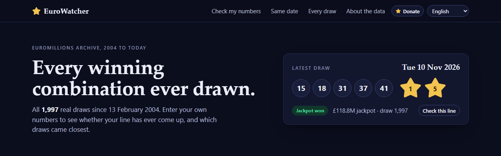
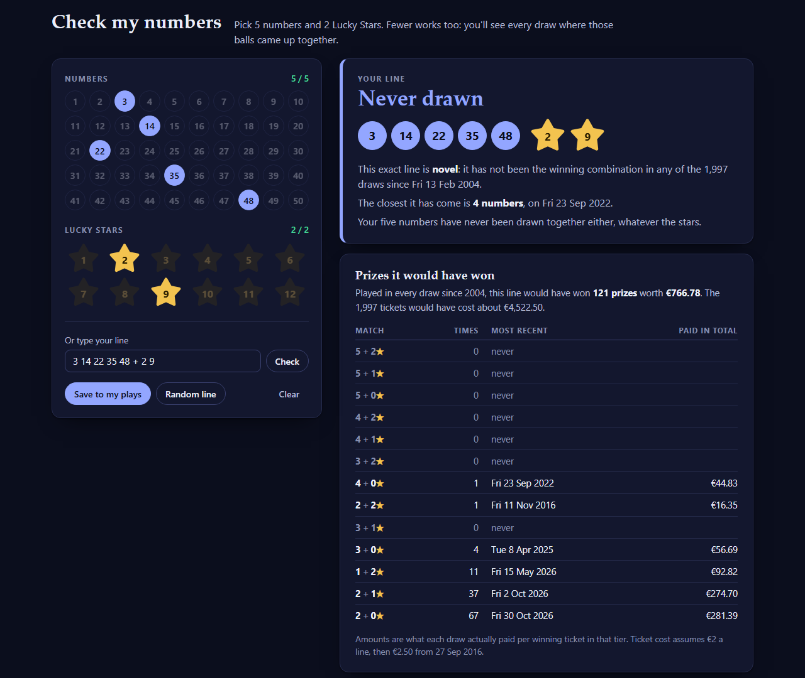
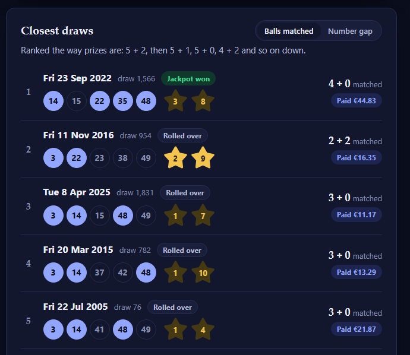
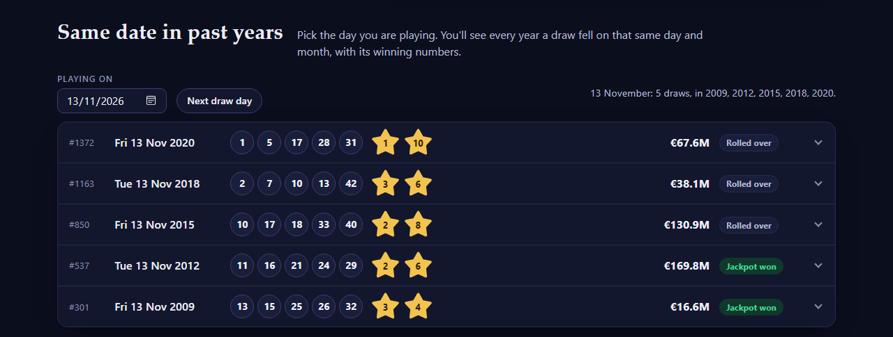
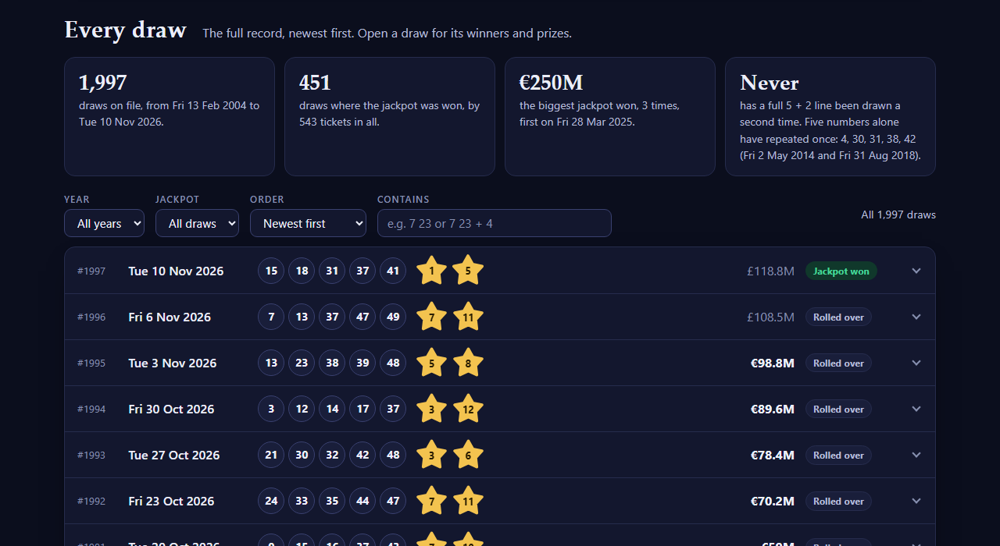
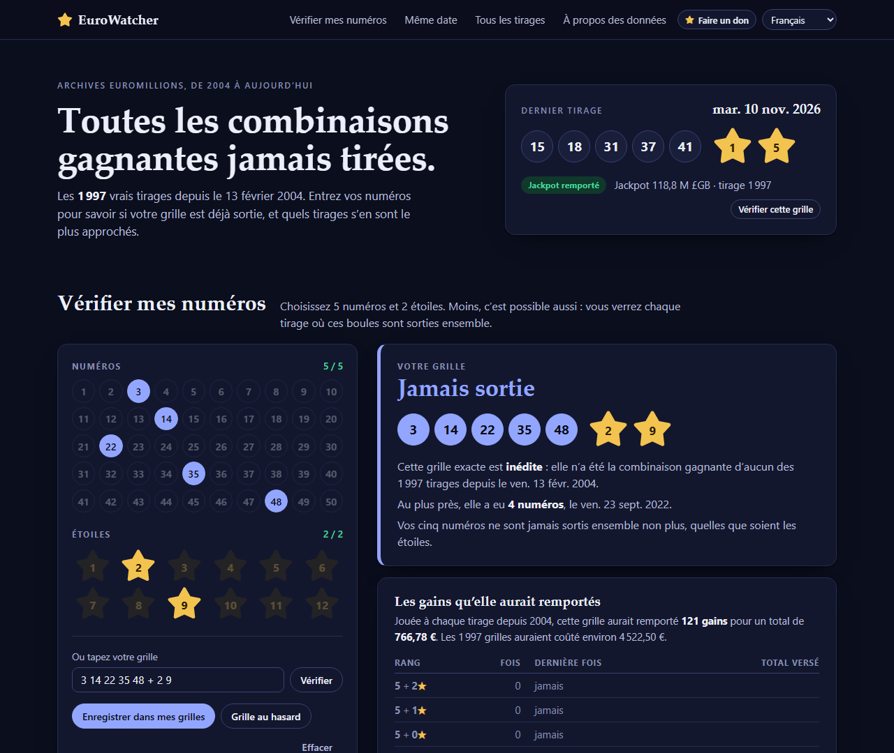

# EuroWatcher

**Every EuroMillions winning combination since the first draw in 2004, checked against your own numbers.**

Free, open source, no ads, no tracking, no account. Available in English, Français, Español, Português,
Deutsch, Nederlands and Italiano.

These are the real results, not predictions or "likely numbers": EuroWatcher only shows what was actually
drawn, and what each draw actually paid.



## What it does

- **Check my numbers.** Pick 5 numbers and 2 Lucky Stars, or type them (`3 14 22 35 48 + 2 9`). You see:
  - whether that exact line has **ever been drawn**, and when, or that it is **novel**;
  - every prize it **would have won** if you had played it in every draw, with dates and the amounts paid;
  - the **closest draws**, ranked by balls matched or by how far the drawn numbers sit from yours.

  

  

- **Fewer balls work too.** Pick 2, 3 or 4 balls to see every draw where they came up together.
- **Same date in past years.** Choose the day you are playing (a Tuesday or a Friday) and see every earlier
  draw held on that same day and month, with its winning numbers.

  

- **Every draw.** The full record with its winners and prizes per tier, filtered by year, jackpot won or not,
  or the balls it contains.

  

- **My plays.** Save your lines; each one shows its best result ever and how it did in the latest draw.
- **New draws.** The installed app notices when a Tuesday or Friday draw has been held since your data was
  last updated and offers to fetch it with one click.

*In seven languages; here in French:*



*The pictures show real draws, as on the day they were taken.*

## Install

### Windows 10 / 11

1. Download **`EuroWatcherSetup.exe`** from the [latest release](https://github.com/Mohenni/EuroWatcher/releases/latest).
2. Run it and press Install.

Good to know:

- It installs for **your Windows account only**, so it needs no administrator permission.
- **Windows will warn you** ("Windows protected your PC" / "Unknown publisher"). EuroWatcher is not
  code-signed, because a certificate costs money every year. Choose *More info* > *Run anyway*, or
  [build it yourself](#build-it-yourself) in a few seconds.
- EuroWatcher opens in its own window (it uses Microsoft Edge, which every Windows 10/11 PC has).
- The release files are built by GitHub from this source code (see `.github/workflows/release.yml`),
  not uploaded by hand. `SHA256SUMS.txt` lists their checksums.
- Remove it under *Settings > Apps*. You choose whether your saved plays are deleted too.

### Linux and macOS

```sh
curl -fsSL https://raw.githubusercontent.com/Mohenni/EuroWatcher/main/install.sh | sh
```

or from a copy of this project: `sh install.sh`.

It needs only Python 3.7 or newer, which Linux distributions and macOS (with the Xcode command line tools)
already include. You then find **EuroWatcher** in your applications menu, Launchpad or Spotlight, or start it
with the command `eurowatcher`. It opens in its own window when Chrome, Chromium, Edge or Brave is installed,
otherwise in your usual browser. Remove it with `sh install.sh --uninstall`
(add `--purge` to delete your saved data as well).

### Without installing anything

Download this project and open `index.html` in your browser. Everything works except the one-click
update; run `node tools/update-data.mjs` to fetch new draws instead.

## Where the data comes from

Three public sources, read only (EuroWatcher sends nothing about you anywhere):

| Source | Used for |
| --- | --- |
| [Merseyworld lottery archive](https://lottery.merseyworld.com/Euro/) | Draw numbers, dates and balls for every draw |
| [EuroMillions API](https://euromillions.api.pedromealha.dev/) | A second copy of the balls, plus winners and prizes in euros |
| [UK National Lottery](https://www.national-lottery.co.uk/results/euromillions/draw-history) | The official record of the latest draw |

Every draw that two sources both have must agree ball for ball, or the update stops and the existing data
is kept. The same check runs in the Windows app, the Linux/macOS app and `tools/update-data.mjs`, and all
three produce identical files.

GitHub refreshes `data/draws.js` in this repository every Wednesday and Saturday morning
(`.github/workflows/update-data.yml`). The apps use that copy only when the sources above cannot be reached.

## Build it yourself

**Windows:** double-click `build.bat`. It uses the C# compiler that is part of Windows and produces
`EuroWatcherSetup.exe` and `bin\EuroWatcher.exe`. Nothing needs to be installed first.

**Linux / macOS:** nothing to build; `unix/eurowatcher.py` is the whole program.

## Project layout

| Path | What it is |
| --- | --- |
| `index.html`, `styles.css`, `app.js`, `i18n.js` | The page, used by every edition |
| `data/draws.js` | The draw history |
| `tools/update-data.mjs` | Rebuilds the draw history (Node 18 or newer) |
| `desktop/` | The Windows program and its installer (C#) |
| `unix/eurowatcher.py`, `install.sh` | The Linux and macOS edition |
| `assets/` | Icons; `tools/make-icon.ps1` draws them |
| `docs/` | The pictures on this page |

## Licence

MIT. EuroWatcher is an independent record and is not affiliated with any lottery operator. Always confirm
results and prizes with your official operator.
